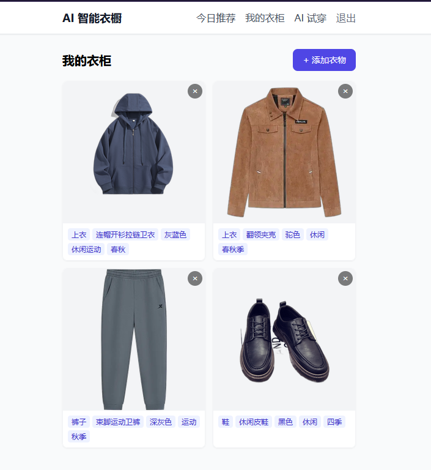
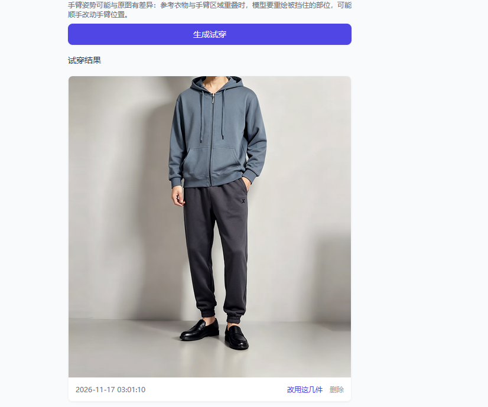
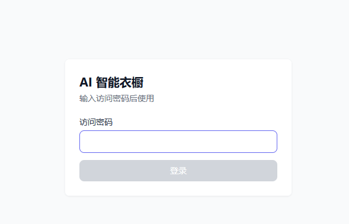
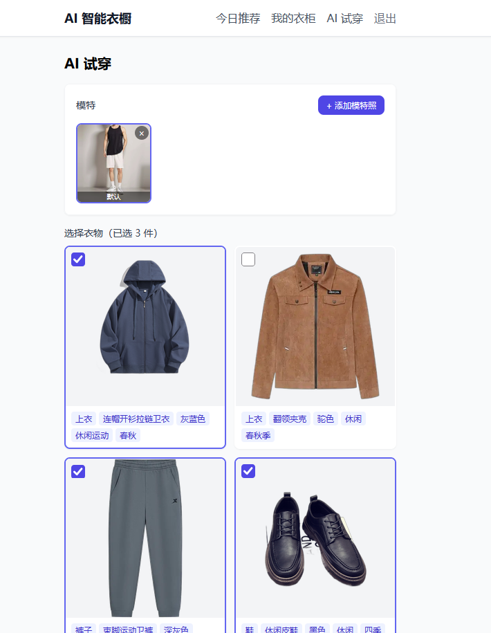
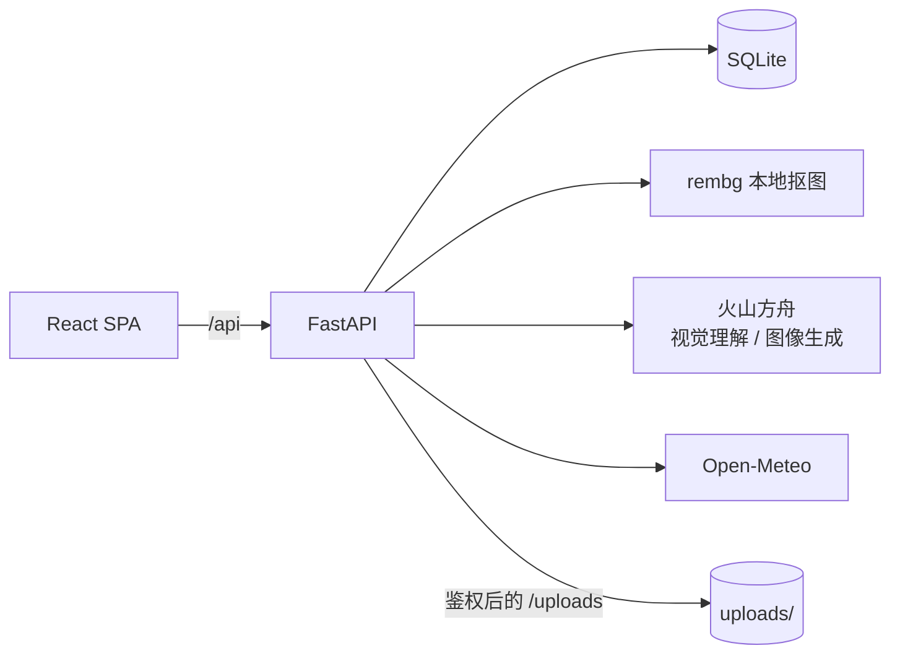

# AI 智能衣橱 (AI Wardrobe)

上传衣物照片，AI 自动抠图与识别入库；结合实时天气生成穿搭推荐，并支持 AI 虚拟试穿。

React + FastAPI 全栈项目，后端 367 / 前端 146 个自动化测试。

## 预览

| 我的衣柜 | AI 试穿结果 |
|:---:|:---:|
|  |  |

| 登录页 | 试穿选择 |
|:---:|:---:|
|  |  |

## 功能

- **衣物入库**：上传照片 → rembg 本地抠图 → 多模态模型识别品类/颜色/风格/季节 → SQLite
- **我的衣柜**：网格展示、按部位归组、删除（原图与抠图一并清理）
- **今日推荐**：Open-Meteo 实时天气 + 规则筛选 + LLM 精选；LLM 不可用时自动降级为纯规则
- **AI 试穿**：模特管理、多件衣物组合、对比生成、历史记录
- **登录鉴权**：单用户密码登录，所有业务 API 与图片资源都要求有效会话

## 技术栈

| 层 | 技术 |
|---|---|
| 前端 | React 18、Vite 5、TypeScript、Tailwind CSS 3、React Router |
| 后端 | FastAPI、Uvicorn、aiosqlite |
| 数据库 | SQLite（单文件） |
| AI | 火山方舟 Seedream（视觉理解 + 图像生成）、rembg U2-Net 本地抠图 |
| 天气 | Open-Meteo（免费、无需 Key） |
| 测试 | pytest、vitest + Testing Library |

## 架构



- 推荐链路：规则筛选（季节 / 场合 / 温度）→ LLM 精选 → 校验返回 id → 任何异常降级为纯规则
- 试穿链路：模特原图 + 衣物原图 → prompt 构建 → 图像编辑模型 → 结果落盘
- 鉴权：HMAC 签名的 HttpOnly cookie，签名密钥派生自密码哈希 —— 改密码即让所有旧会话失效

## 快速开始

### 前置

- Python 3.10
- Node.js 18+
- （可选）火山方舟 API Key，以及账号下已开通的视觉 / 图像模型

### 1. 启动后端

```bash
cd backend

# 创建虚拟环境（Windows 用 venv\Scripts\ 下的可执行文件）
python3.10 -m venv venv
source venv/bin/activate        # Windows: venv\Scripts\activate

pip install -r requirements.txt

cp .env.example .env
python scripts/set_password.py  # 设置登录密码，写入 APP_PASSWORD_HASH

python -m uvicorn main:app --port 8000
```

首次抠图前需要 rembg 的 U2-Net 模型（168MB）。不手动下载也会自动拉取，但国内直连较慢：

```bash
mkdir -p ~/.u2net
curl -L -o ~/.u2net/u2net.onnx \
  "https://gh-proxy.com/https://github.com/danielgatis/rembg/releases/download/v0.0.0/u2net.onnx"
```

> Windows PowerShell 下把 `~/.u2net` 换成 `$env:USERPROFILE\.u2net`。

### 2. 启动前端

```bash
cd frontend
npm install
npm run dev
```

打开 <http://localhost:5173>。开发环境下 `/api` 与 `/uploads` 由 Vite 代理到 `http://localhost:8000`。

## 配置

`backend/.env`（从 `backend/.env.example` 复制）：

| 变量 | 说明 |
|---|---|
| `SEEDREAM_API_KEY` | 留空也能运行：跳过 AI 识别，推荐降级为规则，试穿不可用 |
| `SEEDREAM_VISION_MODEL` | 衣物识别模型，以方舟控制台已开通的模型为准 |
| `SEEDREAM_IMAGE_MODEL` | 图像生成模型，写入 `outfits.generated_by` |
| `ARK_BASE_URL` | 火山方舟 API 地址 |
| `APP_PASSWORD_HASH` | 由 `scripts/set_password.py` 生成，不要手写 |
| `APP_COOKIE_SECURE` | HTTPS 部署时设为 `true`；http 下设 `true` 会导致「登录成功但立刻未登录」 |

修改 `.env` 或重置密码后必须重启后端（配置在进程启动时读取）。

## 测试

```bash
cd backend && pytest -q          # 367 passed
cd frontend && npm test          # 146 passed
```

## 已知限制

试穿基于通用图像编辑模型（而非专用换装模型），实测存在三条限制：

1. **参考衣物与手臂区域重叠时，手臂姿势可能漂移**。两轮 prompt 调优共 19 次真实调用均无改善，属于模型能力边界（缺少 mask 与 pose 条件）。
2. **参考图水印可能偶发传染到成图**（实测 1/9），代价是衣物自带品牌标志可能一起丢失。
3. **输出存在抖动**：同一输入多次生成结果可能不同，单张结果不可信，重跑是当前唯一缓解手段。

其他：

- 单用户设计（`user_id` 固定为 1），不含注册与多用户隔离
- 登录失败限流是进程内的，多 worker 部署时各进程独立计数
- 未提供 Docker Compose 部署

## 安全说明

- `.env`、SQLite 数据库、上传图片均被 `.gitignore` 排除，不会进入仓库
- 密码只存 PBKDF2 哈希；会话 cookie 为 HttpOnly + SameSite=Strict，无 CORS
- 部署到公网时：务必设置强密码、启用 HTTPS，并将 `APP_COOKIE_SECURE` 设为 `true`

## 目录结构

```
backend/
├── api/            # auth / upload / wardrobe / recommendation / model / tryon
├── services/       # rembg、火山方舟客户端、天气、推荐与试穿编排
├── storage/        # SQLite 数据访问与上传文件路径解析
├── security/       # 密码哈希、会话签名、登录限流、.env 写入
├── scripts/        # set_password.py
├── tests/          # pytest
└── uploads/        # 运行时生成，不提交
frontend/
├── src/pages/      # 今日推荐 / 衣柜 / 试穿 / 登录
├── src/components/ # WardrobeGrid
├── src/utils/      # 纯函数（试穿组合、URL 安全跳转等）
└── src/api/        # fetch 封装与 401 处理
```

## 开发方式

TDD：先写失败测试再实现，后端 pytest、前端 vitest。开发过程中的技术约定、踩坑记录与实测结论固化在 [`CLAUDE.md`](CLAUDE.md)，完整方案见 [`PLAN.md`](PLAN.md)。

## License

[MIT](LICENSE)
